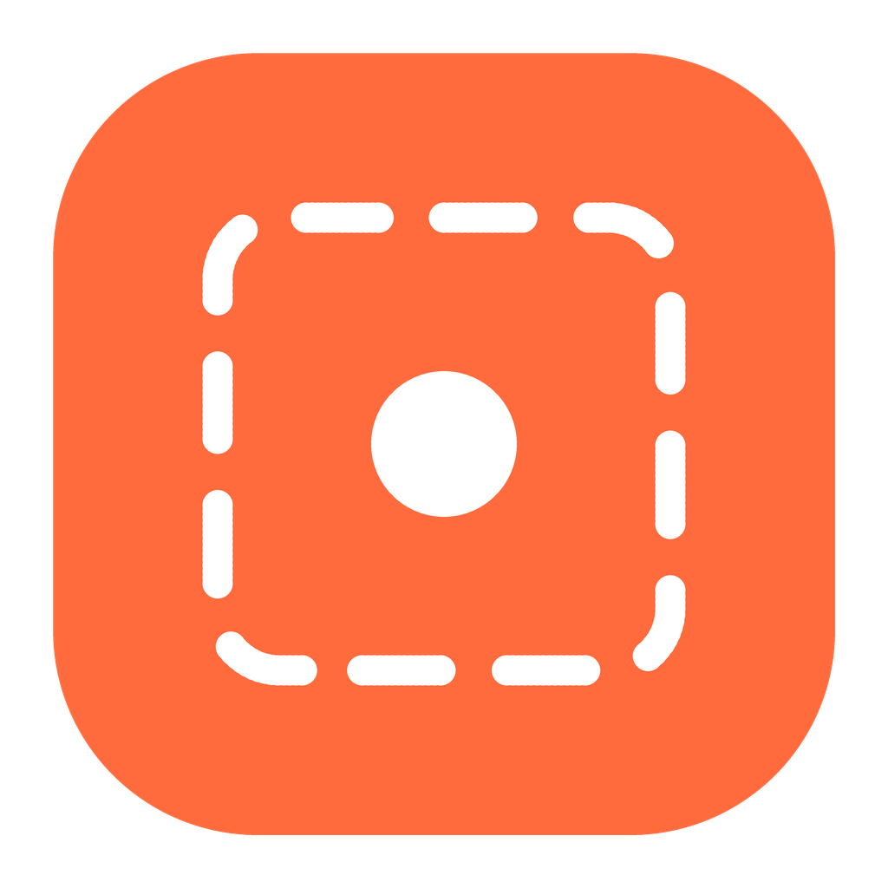

<div align="center">



# PixPeel

**一键把截图 / 图片里的每个元素拆出来，存成透明底 PNG 贴纸。**

[English](README.en.md) · 简体中文

</div>

按快捷键 → 框选屏幕（或直接点屏幕上的元素）→ 自动拆元素 → 挑想要的 → 保存到素材库。
全程在本机完成，不上传图片，不需要账号。

## 功能

- **框选提取**：快捷键后屏幕变暗，拖出一块区域，自动拆开其中的元素，挑想要的存成透明底 PNG。
- **点选提取**：屏幕不变暗，鼠标移到哪个元素就高亮哪个，点一下直接存进素材库，可连续点。
- **导入图片**：按钮、拖入、`Ctrl+V` 粘贴都行。
- **精修工具**：点选 / 魔棒 / 套索 / AI 点选（可选，首次联网下载一个小模型，国内会自动走 hf-mirror 镜像）；可导出分层 SVG。AI 模型有两种：**量化版**（默认，十几 MB、快、省内存）和**浮点版**（精度略高，体积和内存都要多一倍多），在设置里可以随时换。
- **画板**：用素材库里的元素或导入的图片拼图，选画布大小和透明 / 纯色背景，可移动、缩放、旋转、删除，导出 PNG / JPG 或存回素材库。
- **撤回 / 缩放 / 快捷键**：拆元素页和画板都能 Ctrl+Z 撤回、Ctrl+Shift+Z 重做，滚轮缩放、空格拖动平移；设置里可查看全部快捷键。
- **高清修复**：素材库里标出低分辨率素材，一键放大并锐化（纯本机计算，不是 AI 生成），另存为 `-HD` 新图，原图保留。除了 Lanczos 放大和反锐化，还加了迭代反投影和去边处理，轮廓更实、白边黑边更少。
- **素材库**：点击复制到剪贴板、在文件夹中显示、删除（进回收站）；删除后有 3 秒的「撤回」提示。
- **SVG 库 / SVG 画布**：分层 SVG 单独收进 SVG 库；SVG 画布里能逐层显示/隐藏、移动、缩放、旋转、改透明度，也能把某一层导成透明 PNG 存回素材库。
- **和“小剪动画”联动**：保存的元素自动出现在小剪动画的贴图素材里。
- **拖图进来**：把图片从桌面拖到任意一页——拆元素页就拆解，画板就当素材（第一张当底图），素材库直接存进去，SVG 库就当 SVG 处理。
- **常驻托盘**、开机自启（可选）、保存后系统通知（点击即可打开素材库）。
- 简体中文 / English，浅色 / 深色 / 跟随系统。

## 下载安装

到 [Releases](https://github.com/ijijv/PixPeel/releases) 下载对应你系统的文件：

| 系统 | 文件 | 说明 |
| --- | --- | --- |
| Windows（不知道自己是哪种？下这个） | `PixPeel-Setup-x.y.z-win.exe` | 一个安装包自动适配 64 位 / 32 位 / ARM，体积约 230 MB |
| Windows 64 位（绝大多数电脑） | `PixPeel-Setup-x.y.z-win-x64.exe` | 安装向导：许可协议 → 选择路径 → 安装进度 → 可选创建桌面快捷方式 |
| Windows 32 位 | `PixPeel-Setup-x.y.z-win-ia32.exe` | 老电脑 |
| Windows on ARM | `PixPeel-Setup-x.y.z-win-arm64.exe` | |
| macOS Apple 芯片 (M1/M2/M3…) | `PixPeel-x.y.z-mac-arm64.dmg` | 同版本也有 `.zip` |
| macOS Intel | `PixPeel-x.y.z-mac-x64.dmg` | 同版本也有 `.zip` |
| Linux 64 位 | `PixPeel-x.y.z-linux-x86_64.AppImage` / `…-linux-amd64.deb` / `…-linux-x86_64.rpm` | 免安装用 AppImage，Debian / Ubuntu 用 deb，Fedora / openSUSE 用 rpm |
| Linux ARM64 | `PixPeel-x.y.z-linux-arm64.AppImage` / `…-linux-arm64.deb` / `…-linux-aarch64.rpm` | 树莓派等 |

每个版本附带 `SHA256SUMS.txt`，可用来校验下载是否完整。

另外还有配套的网页版动画编辑器「小剪动画」，单独下载即可，不用装 PixPeel 也能用：
[xiaoji-animation.html](https://github.com/ijijv/PixPeel/releases/latest/download/xiaoji-animation.html)。

**升级**：直接运行新版安装包，会自动覆盖旧版，设置和素材都保留。

### 首次运行的提示

安装包没有购买商业代码签名证书（那个要花钱），所以系统会显示“未知发布者”，这是正常现象，不是病毒。

- **Windows**：可能出现“Windows 已保护你的电脑”（SmartScreen）→ 点“更多信息” → “仍要运行”。
- **macOS**：打开 dmg 把 PixPeel 拖进“应用程序”。第一次若提示“已损坏 / 无法验证开发者”，在终端执行：
  `xattr -cr /Applications/PixPeel.app`，或右键 → 打开。然后在 **系统设置 → 隐私与安全性 → 屏幕录制** 勾选 PixPeel，重启软件。
- **Linux**：`chmod +x PixPeel-*.AppImage && ./PixPeel-*.AppImage`。Wayland 下全局快捷键和屏幕截取受系统限制，建议在 X11 会话里使用（见下方“已知限制”）。

## 使用

| 操作 | 默认快捷键（Mac 上 Ctrl 换成 ⌘） |
| --- | --- |
| 框选提取 | `Ctrl + Shift + X` |
| 点选提取 | `Ctrl + Alt + X` |

两个快捷键都可以在 **设置** 里修改。框选后：点图上的元素选中 → `Enter` 保存 → 窗口自动收进托盘。点选提取时：滚轮调整范围，`Esc` 或右键结束。

素材默认保存在 `图片/PixPeel`，可在设置里改。

### 和“小剪动画”联动

“小剪动画”是另一个配套工具（一个跑在浏览器里的本地动画编辑器），和 PixPeel 是两个独立的软件。只有你想拿它做动画时才需要这一步；只是想把图片拆成透明贴纸的话，完全不用管它。

1. 下载 [xiaoji-animation.html](https://github.com/ijijv/PixPeel/releases/latest/download/xiaoji-animation.html)（就是「小剪动画」，单文件网页版，双击就能用，不用装任何东西）。
2. 在 PixPeel 设置里确认“允许小剪动画读取素材库”已开启（默认 `127.0.0.1:17652`，只在本机可访问）。
3. 用浏览器打开**下载到本地的 xiaoji-animation.html**，进入左侧“贴纸”，点“连接 PixPeel 桌面版”。
4. 之后新保存的元素会自动出现在贴图里；也可以勾上“自动同步”，桌面版一存新元素就自动进贴图。

> 在线网页可能被浏览器拦截对本机地址的访问，请使用下载到本地的页面文件。

## 设置里有什么

语言、主题、保存位置、两个快捷键、开机自启、关闭窗口时的行为（托盘 / 退出）、系统通知、联动服务与端口、启动时检查更新 + 手动检查、更新日志、隐私政策、开源协议、项目主页、设置文件夹、恢复默认设置。

## 从源码运行 / 自己打包

需要 [Node.js](https://nodejs.org) 20+。

```bash
npm install
npm start            # 开发运行

npm run dist:win     # 仅 Windows 机器上：生成 x64 / ia32 / arm64 三个安装包（只要 64 位用 npm run dist:win64）
npm run dist:mac     # 仅 macOS 机器上：生成 dmg + zip（x64 / arm64）
npm run dist:linux   # Linux 机器上：AppImage / deb / rpm（x64 / arm64）
```

产物在 `dist/`。macOS 包只能在 macOS 上打，所以跨平台发布建议用 GitHub Actions。

> rpm 包依赖构建机上 `rpmbuild` 的版本：新版 rpm（6.x）去掉了 `xzmt` 压缩，老的 electron-builder 打不出来。
> 只想稳妥拿到 AppImage 和 deb，用 `npm run dist:linux:core`；单独补 rpm 用 `npm run dist:linux:rpm`。

国内网络下载 Electron 慢时：

```bash
# Windows PowerShell
$env:ELECTRON_MIRROR="https://npmmirror.com/mirrors/electron/"; $env:ELECTRON_BUILDER_BINARIES_MIRROR="https://npmmirror.com/mirrors/electron-builder-binaries/"; npm install
```

发布新版本的完整步骤见 [docs/RELEASING.md](docs/RELEASING.md)。

### 目录

```
main.js  preload.js  lib.js  server.js  config.js   主进程与本地联动服务
overlay.html  live.html                              框选层 / 点选提取层
renderer/   界面、多语言（i18n.js）、拆元素引擎（engine.js）
build/      图标、托盘图标、安装向导脚本与许可协议
docs/       更新日志、隐私政策（软件内也会显示）、发布说明、联动协议
editor/     xiaoji-animation.html（配套的网页版动画编辑器「小剪动画」，单文件）
tools/      图标生成脚本
```

## 已知限制

- 元素放在复杂花哨的背景上时，自动判断可能取到整块背景，请用魔棒 / 套索 / AI 点选。
- Linux Wayland 下全局快捷键、屏幕截取和透明覆盖层可能不可用；托盘图标在 GNOME 上需要 AppIndicator 扩展。
- 安装包未签名（见上）；自动更新目前是“检查到新版本后带你去下载页”，没有静默替换。
- 卸载前先从托盘里退出 PixPeel，否则卸载程序会认为应用还在运行。

## 隐私

不收集任何数据，图片只在本机处理。详见 [docs/PRIVACY.zh-CN.md](docs/PRIVACY.zh-CN.md)。

## 许可

[MIT](LICENSE)
